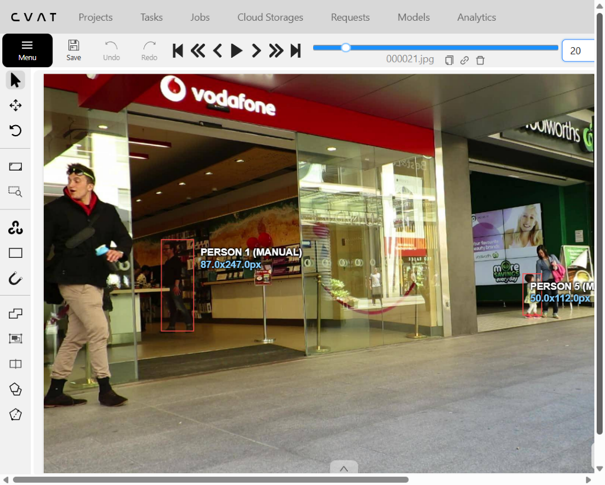
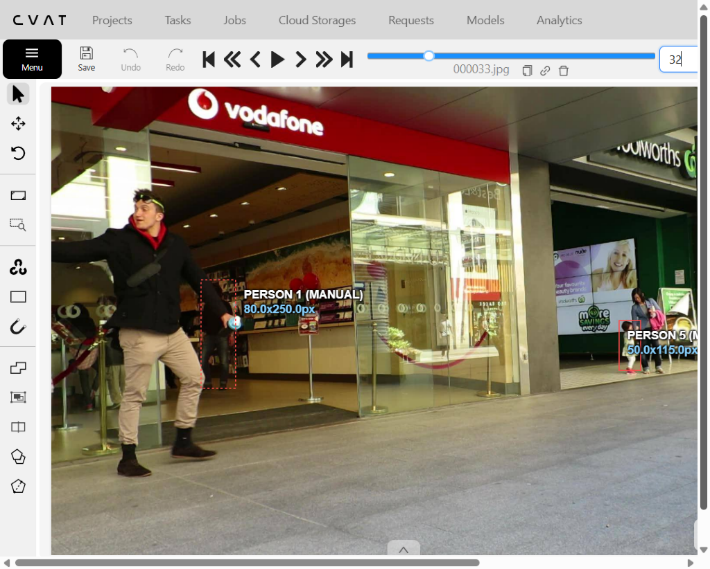

# Báo cáo cá nhân — TrinhXuanToan-2A202603121

> **BẢN NHÁP — chưa đủ điều kiện nộp.** Số liệu bên dưới được trích từ hai ZIP hiện có, không phải dữ liệu ước lượng. Hai file không đồng nhất: MOT có 5 ID nhưng CVAT chỉ có 3 track. P1–P3 được đối chiếu với điểm nhận diện đề B; P4/P5 chưa thể xác nhận trong ZIP CVAT. Cần xuất lại cả hai từ cùng job cuối và bổ sung nội dung cá nhân còn thiếu.

Đoạn video: MOT17-09, 150 frame (frame 1–150), nguồn MOTChallenge, giấy phép CC BY-NC-SA 3.0.

## 0. Thông tin học viên

- Họ tên: Trinh Xuan Toan
- MSSV: 2A202603121
- Mã đề (A/B/C): B
- Email: Chưa cung cấp
- Link repository: https://github.com/trytocode05/K5-L2-DAY05-TrinhXuanToan-2A202603121-MOTTracking
- Giờ bắt đầu: Chưa cung cấp
- Giờ kết thúc: Chưa cung cấp

## 1. Xem trước đoạn video (CP0)

Ghi **trước khi vẽ**, mỗi người một dòng.

| Mã | Frame xuất hiện | Frame cuối thấy được | Rẽ / dừng / đổi tốc độ ở frame | Bị che ở frame | Ghi chú |
|---|---|---|---|---|---|
| P1 | 0 | 149 | Chưa ghi | 34–51 | Khoảng có box trích từ MOT ID 1; frame 39–44 vắng |
| P2 | 0 | 149 | Chưa ghi | Không có cờ trong CVAT | Điểm nhận diện khớp CVAT track 1 / MOT ID 2 |
| P3 | 1 | 149 | Chưa ghi | 0–23, 26, 38, 40 (CVAT có cờ) | Điểm nhận diện khớp CVAT track 2 / MOT ID 3; MOT vắng frame 2–5 |
| P4 | Chưa xác định | Chưa xác định | Chưa ghi | Không có trong ZIP CVAT | Không thể xác nhận mapping với MOT ID 4 |
| P5 | Chưa xác định | Chưa xác định | Chưa ghi | Không có trong ZIP CVAT | Không thể xác nhận mapping với MOT ID 5 |

Khoảng frame là dữ liệu trích từ bản xuất cuối, không phải ghi chép xem trước CP0. Mốc rẽ/dừng/đổi tốc độ không thể xác định đáng tin cậy chỉ từ các ZIP.

## 2. Keyframe và thời gian (CP1, CP4)

Số keyframe lấy từ kết quả `src/check_submission.py`.

| Mã | Số keyframe | Keyframe ở frame | Số frame có mặt | Keyframe / 100 frame | Thời gian (phút) | Chỗ khó |
|---|---|---|---|---|---|---|
| P1 (CVAT 0) | 82 | 0, 8–21, 30, 34–35, 45, 50, 52, 56, 59, 61–65, 67–72, 74, 78–79, 81–88, 90–93, 95, 98–99, 101–102, 107–117, 119–122, 124, 127–129, 132–133, 136–137, 142–144, 147–148 | 144 | 56.9 | Chưa cung cấp | Mật độ keyframe vượt ngưỡng |
| P2 (CVAT 1) | 60 | 0–7, 9–14, 16–18, 20, 23, 25, 32–33, 35–36, 43, 48, 53, 56, 63, 73, 78, 80, 83–84, 88, 90–91, 93–94, 104, 107–110, 114, 117–118, 122, 124, 126–129, 134, 137, 139, 141, 144, 148–149 | 150 | 40.0 | Chưa cung cấp | — |
| P3 (CVAT 2) | 136 | 0–43, 45–46, 48–51, 53–55, 57–59, 62–121, 124–134, 136–139, 142, 144, 147–149 | 150 | 90.7 | Chưa cung cấp | Mật độ keyframe cao |
| P4 | Không có trong ZIP CVAT | — | — | — | Chưa cung cấp | Bản CVAT hiện tại thiếu track |
| P5 | Không có trong ZIP CVAT | — | — | — | Chưa cung cấp | Bản CVAT hiện tại thiếu track |
| **Tổng CVAT hiện có** | **278** | — | **444** | **62.6** | Chưa cung cấp | Chỉ gồm 3 track |

Các frame keyframe được rút gọn thành dải liên tiếp (ví dụ `8–21`). Mapping P1–P3 dựa trên box của track chứa điểm nhận diện ở frame tham chiếu đề B. Thời gian gán của từng người không có trong ZIP.

Thời gian làm và người có nhiều keyframe nhất: Chưa cung cấp / chưa xác định.

## 3. Đoạn bị che (CP2)

Người bị che: P1 (đối chiếu với CVAT track 0)

| Mốc | Frame |
|---|---:|
| Bắt đầu bị che một phần (bật `occluded`) | 34 |
| Mất hẳn (bật `outside`) | 39 |
| Hiện lại (tắt `outside`) | 45 |
| Thấy rõ trở lại (tắt `occluded`) | 52 |

- Thời gian khuất hẳn: 6 frame (39–44) = 0.2 giây ở 30 fps.
- Quyết định thể hiện trong file: giữ cùng CVAT track 0 trước và sau đoạn khuất.
- Theo ngưỡng lớp, 6 frame ngắn hơn 60 frame. Lý do nhận dạng ngoại hình/hướng đi cần học viên xác nhận bằng video; ZIP chỉ cho biết cờ và ID.

Ảnh hiện đính kèm là walkthrough minh họa, không phải bằng chứng job cá nhân; thay bằng ảnh chụp job CVAT trước khi nộp:





## 4. Tự review ID (CP3)

Lượt 1 theo người (đi ngược từ frame 149 về 0 trên CVAT), lượt 2 theo cảnh (nhảy 10 frame). Ít nhất 3 dòng; không có lỗi thì ghi một dòng "đã kiểm hai lượt, không lỗi".

Loại lỗi dùng đúng một trong 7 mã: `id_switch`, `fragmentation`, `lost`, `merge`, `false_track`, `drift`, `flag`.

| Frame | Mã người | Loại lỗi | Mô tả một câu | Phát hiện ở lượt | Đã sửa? |
|---:|---|---|---|---|---|
| — | — | — | Đã kiểm hai lượt, không lỗi (theo xác nhận học viên). | Hai lượt | Không có lỗi cần sửa |

Tổng hợp số lỗi theo loại:

| `id_switch` | `fragmentation` | `lost` | `merge` | `false_track` | `drift` | `flag` |
|---:|---:|---:|---:|---:|---:|---:|
| 0 | 0 | 0 | 0 | 0 | 0 | 0 |

Lỗi chỉ lượt 2 phát hiện: Không có (theo xác nhận học viên).

## 5. File xuất và kết quả tự kiểm (CP4)

| Kiểm tra | Kết quả |
|---|---|
| Tên file MOT 1.1 | `TrinhXuanToan_mot.zip` |
| Tên file CVAT for video 1.1 | `TrinhXuanToan_cvat_video.zip` |
| Số track ID khác nhau trong `gt/gt.txt` (phải là 5) | 5 |
| Frame `outside` không có dòng trong `gt.txt` (đúng / sai) | P1: đúng, frame 39–44 không có dòng; cần xác nhận lại sau khi đồng bộ hai ZIP |
| Job đã completed trên CVAT máy cá nhân | Có (học viên xác nhận) |

Kết quả chạy checker hiện tại (**chưa phải kết quả cuối**):

```text
MOT: 5 track ID, 653 box; đúng số ID mong đợi.
CVAT for video: chỉ 3 track (job #18), 444 frame thấy, 278 keyframe tổng.
Track CVAT 0: 144 frame thấy, 82 keyframe (56.9/100 frame), 12 frame occluded, 1 lần bật outside.
Track CVAT 1: 150 frame thấy, 60 keyframe (40.0/100 frame).
Track CVAT 2: 150 frame thấy, 136 keyframe (90.7/100 frame), 27 frame occluded.
Cảnh báo: mật độ keyframe cao ở track CVAT 0 và 2.
Tóm tắt checker: 0 lỗi định dạng, 2 cảnh báo. Hai file không đồng nhất; cần xuất lại từ cùng job và kiểm tra lại cảnh báo.
Đối chiếu frame: MOT ID 1 vắng 39–44, trùng khoảng outside của CVAT track 0.
```

## 6. Ba câu kết

1. Nếu được gán lại, bạn sẽ đặt keyframe khác ở đâu? Vì sao?

   Chưa cung cấp câu trả lời cá nhân.

2. Có chỗ nào bạn không chắc "cùng ID hay ID mới"? Bạn đã quyết định và ghi chú thế nào?

   Dữ liệu xuất cho thấy P1 giữ cùng track sau khoảng outside 6 frame; chưa có ghi chú để xác nhận đây có phải chỗ học viên phân vân hay không.

3. Một lỗi ID trong job của bạn (nếu không còn sót, chọn lỗi đã sửa) có thể làm xe tự lái dự đoán sai chuyển động của người đó như thế nào? Lỗi đó ảnh hưởng MOTA hay IDF1 nhiều hơn?

   Chưa cung cấp câu trả lời dựa trên một lỗi thật trong job đã sửa.

## Bonus

Không làm bonus (theo xác nhận của học viên).

## 7. Tài liệu tham khảo và công cụ AI đã dùng

MOT17, MOTChallenge (Milan et al., 2016), CC BY-NC-SA 3.0.

Đã dùng trợ lý AI chat để hướng dẫn chạy script tự kiểm, giải thích lỗi PowerShell và hỗ trợ định dạng báo cáo; không dùng AI để sinh box hoặc track ID.
